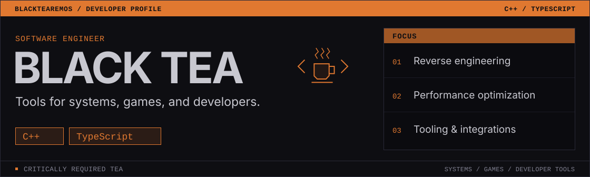

<picture>
  <source media="(max-width: 600px)" srcset="./assets/header-mobile.svg">
  
</picture>

I build tools that make existing systems easier to extend, automate, and use. My main languages are **C++** and **TypeScript**, with a focus on **reverse engineering**, **performance optimization**, and **practical tooling**.

## Wargame: Red Dragon

A connected toolchain for creating, distributing, and loading mods.

| Project | What it does |
| :--- | :--- |
| **[WGRD Mod Toolkit](https://github.com/BlackTeaRemos/WGRD-Mod-Toolkit)** | Mod authoring SDK with a unified interface and automatic application updates. |
| **[WGRD Mod Manager](https://github.com/BlackTeaRemos/WGRD-Mod-Manager)** | Native C++ mod manager with signed releases, BitTorrent v2 distribution, incremental downloads, and mod/profile management. |
| **[WRG-Patcher](https://github.com/BlackTeaRemos/WRG-Patcher)** | C++ x86 proxy DLL for manifest-based redirects and overlays, without modifying the original game files. |

## Developer tools & integrations

| Project | What it does |
| :--- | :--- |
| **[Copilot Adapter Mistral](https://github.com/BlackTeaRemos/Copilot-Adapter-Mistral)** | Mistral model integration for VS Code Copilot Chat, including dynamic model discovery and tool calling. |
| **[Discord-MPG](https://github.com/BlackTeaRemos/Discord-MPG)** | TypeScript content-management platform starter with Discord as the interface and Neo4j-backed data. |
| **[Rimrich REST](https://github.com/BlackTeaRemos/Rimrich-REST)** | Embedded C# REST API for RimWorld, with colony data, controlled game actions, and OpenAPI/Swagger documentation. |

Also: **[CRISP](https://github.com/BlackTeaRemos/CRISP)**: configurable secret scanning in VS Code, using ripgrep and editor diagnostics.

## Working stack

**Primary:** C++ ; TypeScript  
**Also work with:** C# ; Rust ; Lua ; SQF  
**Across these projects:** CMake ; Node.js ; Bun ; Fastify ; Neo4j ; SQLite ; Docker

For bugs and feature requests, open an issue in the relevant repository.

<!---
BlackTeaRemos/BlackTeaRemos is a ✨ special ✨ repository because its `README.md` (this file) appears on your GitHub profile.
You can click the Preview link to take a look at your changes.
--->
